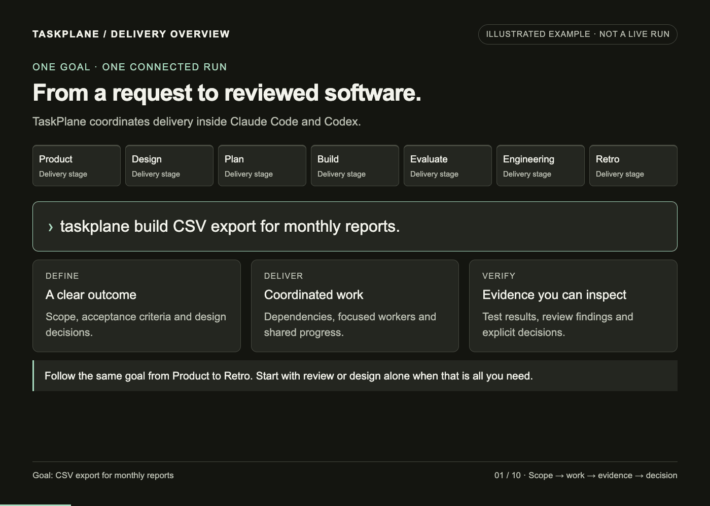

# TaskPlane

**Turn a coding request into a plan, coordinated work, and evidence you can inspect.**

TaskPlane works inside **Claude Code and Codex**. It connects requirements, design decisions, native workers, verification and independent reviews in one run—so you can see what is being built, what was checked, and what still needs a decision.



*Illustrated example: adding CSV export to monthly reports. Sample states, paths and results demonstrate the workflow; this is not a recording or certification of a live run. The animation loops in 56 seconds.*

[Static overview](docs/assets/taskplane-flow-overview.png) · [Step-by-step walkthrough](docs/walkthrough.md) · [Install](#install-and-run-your-first-task) · [Try a task](#four-prompts-to-get-started)

## What TaskPlane brings to a task

- **A clear outcome.** Agree on scope and observable acceptance criteria before implementation.
- **A plan grounded in the code.** Use source dependencies and component boundaries to understand the change.
- **Coordinated native workers.** Run ready, independent tasks concurrently within observed host capacity. Each worker receives focused context and exact task paths; dependent work waits for verified results.
- **Evidence behind completion.** Connect acceptance criteria to captured checks and findings. Keep failures, missing evidence and uncertainty visible.
- **Decisions you control.** Accept a concrete result or request a revision. Authorize automatic continuation when appropriate, with explicit conditions.
- **One place to follow the run.** Inspect progress, task dependencies, review evidence and available token usage in the shared dashboard.

## From request to handoff

**Product → Design → Plan → Build → Evaluate → Engineering → Retro**

| Stage | What you get |
| --- | --- |
| **Product** | An agreed outcome, scope and acceptance criteria. |
| **Design** | A proposed approach, important trade-offs and affected components. |
| **Plan** | Owned tasks, dependencies, allowed paths and required checks. |
| **Build** | Implementation from coordinated workers and integrated results. |
| **Evaluate** | Evidence showing whether each acceptance criterion is met. |
| **Engineering** | Independent reviews with actionable findings and source references. |
| **Retro** | A delivery summary, lessons and explicitly owned follow-up work. |

Each phase carries its artifacts and decisions forward. **Work produced, evidence validated and phase accepted are different states.** Accepting a review does not automatically resolve its findings or authorize code changes.

A full delivery is one route. You can also request Product, Design or Engineering on its own. Findings from a review can become inputs to a separately authorized repair.

## Four prompts to get started

| Your goal | Ask TaskPlane |
| --- | --- |
| Design before coding | `taskplane design safe order cancellation before we build it` |
| Deliver a feature | `taskplane build CSV export for the monthly report` |
| Review without changing code | `taskplane review this branch against main; do not change code` |
| Inspect progress | `taskplane status` |

Use `taskplane help` to explore the routes. TaskPlane selects relevant review lenses and manages its internal commands for you.

## Stay in control

By default, review each phase’s result and approve it before the next phase. Request changes when something needs correction; the decision and revision remain connected to the run.

### Working autonomously

For a bounded task, you can authorize automatic continuation:

```text
taskplane build CSV export for the monthly report.
For this run, auto-approve phases after the required checks pass.
Keep the existing report format and permissions. Pause on a failed check,
uncertain result or scope change. Stop before Retro for my review.
```

The dashboard shows the policy and which phases may continue automatically. Say **“Return to manual approval”** to take back each checkpoint. Host permissions remain authoritative.

## Inspect progress and evidence

The shared dashboard at `.taskplane/dashboard.html` brings together the goal, phase, task graph, source dependencies, findings and verification evidence. It is a snapshot: regenerate it after progress and refresh the view. Check its timestamp, goal and checkout.

In a **supported Claude Mods host**, a status band, checkpoint pane and sequential evidence browser keep that information near the prompt. Inspect a finding’s source and verification, or use **Accept** and **Request changes** for an eligible checkpoint. Other hosts use the conversation and shared dashboard. See [Claude Mods capabilities and host requirements](https://github.com/vdemkiv/taskPlane/blob/main/docs/claude-mods.md).

Run token accounting and context-window usage are separate measurements. Unavailable data stays **Unknown**; partial accounting remains labelled. A token total is not a measure of available account allowance.

## Install and run your first task

You need Python **3.10 or newer**, Git, a local project folder and a Claude Code or Codex installation that supports plugins. Your organization must permit the plugin. Check Python with `python3 --version` on macOS/Linux or `py -3 --version` on Windows.

### Codex

1. Open **Plugins** in the desktop app, or `/plugins` in Codex CLI.
2. Install and enable **taskplane** from your permitted marketplace. If your organization manages plugins, use its catalog or ask an administrator to add the package.
3. Review and trust Taskplane's hook definitions once after installation, and again when definitions change. Codex CLI exposes this under `/hooks`; desktop controls depend on the host version.
4. Start a new task in your project so the installed skills load.

For a configured CLI marketplace, `codex plugin list` shows the available entries and `codex plugin add taskplane@MARKETPLACE` installs the selected one. Confirm the loaded version when updating; a catalog label alone does not prove which package a current task is using.

### Claude Code

Where your organization allows adding a marketplace:

```text
/plugin marketplace add vdemkiv/taskPlane
/plugin install taskplane@taskplane-marketplace
```

Follow the installation's activation or reload instructions, inspect `/plugin` for errors and `/hooks` for the loaded definitions, and accept the host's project trust prompts as appropriate. Managed users install through their organization's catalog.

### Cowork and connected folders

Select the durable project and establish its explicit host/execution path binding
before starting Taskplane. A connected Mac folder establishes neither macOS command
execution nor local worker execution. Preserve the user's execution restriction:
`darwin-local` requires Darwin and current local observations; unknown or conflicting
required observations stop startup or worker dispatch. Installation alone does not
establish Cowork hook, worker or dashboard support. See the
[Cowork setup and evidence limits](docs/onboarding.md#cowork-workspace-and-execution)
before using a connected folder. Live Cowork certification remains unavailable;
the documented contract has automated fixture coverage.

### Try a small real change

Open your repository and ask:

```text
taskplane build a CSV export for the monthly report.
First show me the proposed scope, acceptance criteria and Taskplane dashboard.
```

Taskplane should clarify the result, identify affected components and show the first stage in its own dashboard. Review the scope and reply `approved` or `Changes requested: ...`. Continue with the same task so the decisions and evidence remain connected.

For detailed setup, version checks, updates and troubleshooting, see [Onboarding](docs/onboarding.md). Taskplane's controls use the host's available integration; normal host permissions remain in effect.

## Learn more

- [Visual walkthrough and animation source](docs/walkthrough.md)
- [Onboarding, updates and troubleshooting](docs/onboarding.md)
- [CLI reference](docs/cli-reference.md)
- [Engineering review lenses](docs/lens-catalog.md)
- [Release history](CHANGELOG.md)
- [Privacy](PRIVACY.md) and [Apache-2.0 license](LICENSE)

## Development

Use an isolated Python environment. Install both the quality dependencies and the commented test profile from `requirements-dev.lock`, as CI does. On macOS/Linux:

```sh
python3 -m venv .venv
. .venv/bin/activate
python -m pip install --require-hashes --no-deps -r requirements-dev.lock
awk 'sub(/^# test-lock: /, "")' requirements-dev.lock > .venv/tests.lock
python -m pip install --require-hashes --no-deps -r .venv/tests.lock
python scripts/ci_local.py
```

Add `--browser` for the browser suite. Build the Codex upload archive with `python scripts/package_openai.py`; generated packages go to `dist/`. See the [CI workflow](https://github.com/vdemkiv/taskPlane/blob/main/.github/workflows/ci.yml) for platform-specific checks and profiles.

TaskPlane supplies bounded phase context and command summaries. Use `flow context` to consume current required inputs; new runs require the returned receipt in phase evidence. See [context optimization](docs/cli-reference.md#bounded-context-transport) for receipt semantics and verification reuse.
