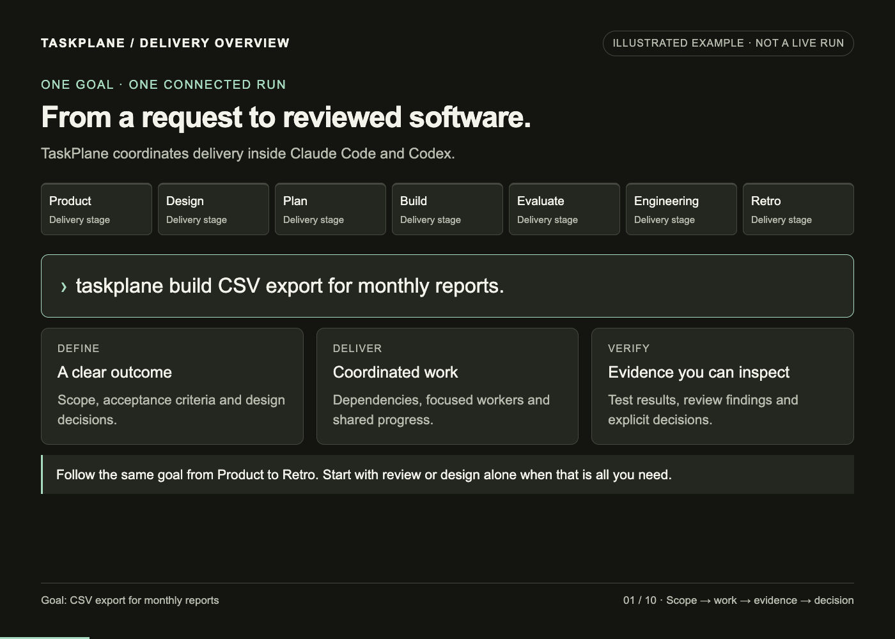

# TaskPlane visual walkthrough

The README animation is a **code-rendered capability example**, not a live run or a record of passing tests. It follows a fictional CSV-export feature through all seven delivery phases.



## The story, at your pace

| Step | Capability shown |
| --- | --- |
| Request | Start with a concrete goal in Claude Code or Codex. |
| Product | Define scope and observable acceptance criteria. |
| Design | Connect the proposed change to source dependencies and verification needs. |
| Plan | Assign owners, paths, dependencies and checks before workers start. |
| Build | Run ready, independent native tasks concurrently; join their results before dependent work. |
| Checkpoint | Inspect work and evidence separately from acceptance. Request changes with a comment. |
| Evaluate | Map each criterion to a result and its verification evidence. |
| Engineering | Follow a stable finding ID to its source, review lens and verification status. |
| Retro | Record the delivery, retained evidence and an explicitly owned deferral. |
| Handoff | Keep the goal, decisions, work and outcomes connected. |

The example’s three passes, two workers, source path and finding are illustrative. It shows F-01 remaining open, then being explicitly deferred with an owner; it does not imply that accepting a review fixes an issue. The Build progress bars are illustrative animation elements, not a claimed TaskPlane progress metric. The selected four review lenses are examples, not the entire lens catalog.

The status band and decision-pane treatment represents Claude Mods where supported. The shared HTML dashboard is read-only; conversation decisions and native host permissions remain authoritative. See [Claude Mods](claude-mods.md) for the actual controls, confirmation flow, eligibility and host limitations.

## Playback and accessibility

- [Animated GIF](assets/taskplane-run-walkthrough.gif): 1400 × 1000 pixels, 10 scenes, 56-second loop.
- [Static overview](assets/taskplane-flow-overview.png): no animation.
- [Self-contained walkthrough source](assets/taskplane-walkthrough/index.html): download and open locally for **Previous**, **Next**, **Play** and **Pause**. It starts paused and makes no network requests. GitHub displays HTML as source rather than executing it.

Every scene is labelled **Illustrated example · Not a live run**. Status uses text as well as color. The README’s phase table and this page provide a text equivalent without requiring animation playback.

## Design provenance

This expands the user-supplied `taskplane-run-walkthrough.gif` (1400 × 1000, 33.34 seconds). That GIF was a CSS reconstruction of a dashboard snapshot dated 14 October 2026 and stopped during Build. The new version reuses its charcoal background, mint accents, phase strip, bordered cards and evidence-table vocabulary. It replaces snapshot-specific remediation text and counters with a clearly labelled full-flow example through Retro. No historical run was edited or presented as complete.

## Regenerate

Edit [index.html](assets/taskplane-walkthrough/index.html), then run [render.py](assets/taskplane-walkthrough/render.py) with Python/Pillow, Node.js and Playwright/Chromium available:

```sh
python3 docs/assets/taskplane-walkthrough/render.py
```

`NODE_BIN` selects Node, `NODE_PATH` can point to an existing package directory, and `CHROME_BIN` can select a local Chrome executable. These are authoring dependencies only; they are not added to TaskPlane’s runtime or CI dependency locks.

The renderer uses a temporary browser profile and temporary frames, checks scene overflow and navigation, and writes the GIF and static PNG. It does not initialize a TaskPlane run or create verification fixtures. Keep the HTML, generated images and timing documentation together when changing the story.
